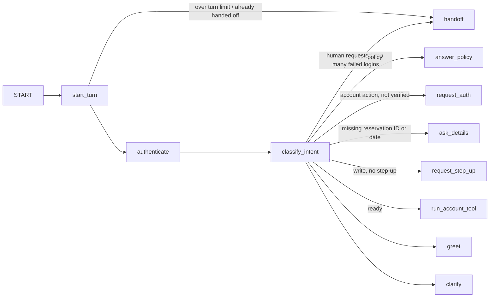

# Flagship Agent — Customer-Service Agent on LangGraph

> **TL;DR** — A car-rental customer-service agent built as a LangGraph `StateGraph` with per-conversation memory (checkpointer keyed by `thread_id`). It authenticates customers, looks up, changes and cancels reservations, answers policy questions, and hands off to a human. Account actions require authentication, writes require single-use step-up re-authentication, every write carries an idempotency key, and customers can only touch their own reservations. 40 tests assert tool trajectories across multi-turn conversations without touching the network.

> **Tags:** `langgraph`, `stategraph`, `checkpointer`, `tool-calling`, `step-up-auth`, `idempotency`, `handoff`, `tool-trajectory`

## Graph

One graph invocation handles one user turn. State persists between turns through the checkpointer.



Every reply node ends the turn (`→ END`).

| Node | What it does |
|------|--------------|
| `start_turn` | Counts turns; past `max_steps` (12) the conversation goes to a human |
| `authenticate` | Verifies `C-xxxxx` + 4-digit PIN found in the message. Credentials sent while a change/cancel is pending grant **step-up**. Three failures hand off |
| `classify_intent` | Keyword classifier (deterministic for tests; one function to swap for an LLM). Keeps the pending action and resumes it when the customer replies with just credentials, an ID or a date |
| `run_account_tool` | Always looks the reservation up first and checks it belongs to the customer, then reads, changes or cancels. Step-up is consumed by the write |
| `answer_policy` | Policy answers need no authentication |
| `handoff` | Transfers to a colleague; later turns only confirm the transfer |

## Example conversation

```
You:   I need to cancel R-00001
Agent: To help with your reservation I need to verify you first. Please send your Customer ID … and your 4-digit PIN.
You:   C-00001 1234
Agent: Done — reservation R-00001 has been cancelled.
       tools: authenticate → lookup_reservation → cancel_reservation
```

A customer who is already verified and then asks to change or cancel is asked to re-confirm their credentials first.

## Run

```bash
cd flagship-agent
python3 -m venv .venv && source .venv/bin/activate
pip install -e ".[dev]"
agent                                              # interactive chat
echo "What is the fuel policy?" | agent --json     # one turn, JSON out
```

Account actions call the [mock-booking-api](../mock-booking-api) at `AGENT_BOOKING_API_BASE` (default `http://localhost:8000`).

```python
from agent import CustomerServiceAgent, last_reply, trajectory

agent = CustomerServiceAgent()
await agent.run("C-00001 1234", thread_id="chat-42")
state = await agent.run("Check reservation R-00001", thread_id="chat-42")
print(last_reply(state))   # Reservation R-00001: Standard, pickup …
print(trajectory(state))   # ['authenticate', 'lookup_reservation']
```

## Tests

```bash
pytest            # 40 tests, coverage gate 80% (currently 99%)
ruff check . && ruff format --check . && mypy --strict src
```

The tests run the real tool code against an in-memory fake of the booking API (`tests/fakes.py`, via `httpx.MockTransport`). They cover:

- account actions blocked until authenticated, with no API calls made
- step-up before writes, wrong PIN at step-up never writes, step-up consumed after one write
- exact tool trajectories, e.g. `authenticate → authenticate → lookup_reservation → change_reservation`
- one idempotency key per write, retries reuse it
- another customer's reservation is invisible
- API outage, unknown reservation and failed writes reported to the customer
- handoff on request, after three failed logins and after the turn limit
- conversation threads isolated from each other; the PIN never appears in the tool trace

CI: [`.github/workflows/flagship-agent.yml`](../.github/workflows/flagship-agent.yml) runs lint, format, `mypy --strict`, tests and `pip-audit`.

## Intentional omissions

- Keyword intent classifier and template replies, no LLM call yet — keeps behaviour deterministic and testable.
- In-memory checkpointer; swap for `SqliteSaver`/`PostgresSaver` to survive restarts.
- Policy answers are a stand-in for the [rag-local](../rag-local) pipeline.
- Mock credentials (`C-00001`/`1234`, `C-00002`/`5678`).
